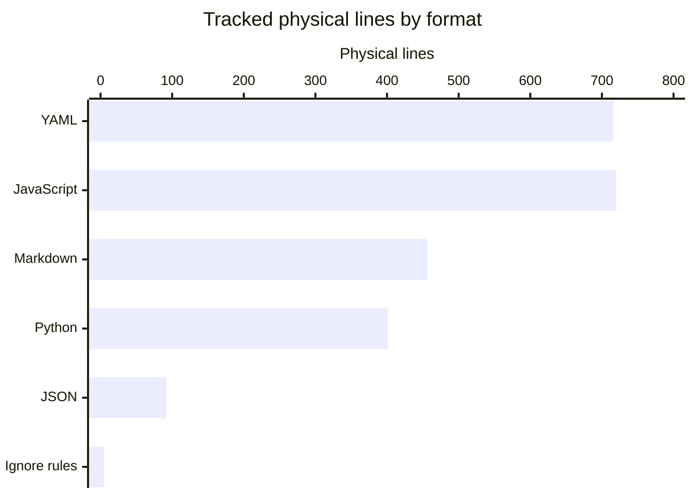

# By the numbers

Data collected **2026-10-23** at `e5535c9`: **24 tracked files, 2,390 physical lines, 124,840 bytes**, and eight commits on `origin/main`. This is a small workflow-and-policy repository, not an application. See [architecture](overview/architecture.md) for the execution boundaries and [lore](lore.md) for the history.

## Measurement scope

The inventory measures the committed HEAD tree with `git ls-tree -r HEAD` and `git show HEAD:<path>`, not the working-tree directory contents. Generated `/droid-wiki/` pages — present in the working tree and staged, but not part of HEAD — and `__pycache__` are excluded. Physical lines include blank lines, comments, prose and data; they are not statement counts or code-only counts. All tracked files are text; a final unterminated line would count as one line. Bytes are the exact Git blob sizes, not filesystem allocation.

Language is assigned by file extension. YAML includes embedded JavaScript and shell; those lines remain YAML rather than being counted twice. Markdown includes operational automation prompts, not just explanatory documentation.

## Language inventory

| Language or format | Files | Physical lines | Bytes |
|---|---:|---:|---:|
| YAML | 6 | 716 | 30,782 |
| JavaScript (`.cjs`) | 2 | 720 | 30,560 |
| Markdown | 11 | 456 | 41,740 |
| Python | 3 | 401 | 16,338 |
| JSON | 1 | 92 | 5,359 |
| Ignore rules | 1 | 5 | 61 |
| **Total** | **24** | **2,390** | **124,840** |

## File roles

These categories are mutually exclusive. Workflow YAML is counted as configuration here, even though it contains executable logic; Markdown prompts are counted with documentation.

| Role | Definition | Files | Lines |
|---|---|---:|---:|
| Source | `/scripts/validate.py` | 1 | 130 |
| Tests | `/tests/` | 4 | 991 |
| Configuration/workflows | `/.github/workflows/`, `/config/jhd.json`, `/.gitignore` | 8 | 813 |
| Documentation/prompts | `/README.md`, `/AGENTS.md`, `/docs/`, `/automations/` | 11 | 456 |

Tests account for **41.46%** of tracked physical lines. This is a size ratio, not a coverage percentage: the tests exercise both Python policy logic and embedded workflow scripts. See [testing](how-to-contribute/testing.md).

## Directory sizes

Directories below are immediate file locations, not recursively overlapping totals. Averages are per tracked file, rounded to two decimal places.

| Directory | Files | Lines | Bytes | Mean lines/file | Mean bytes/file |
|---|---:|---:|---:|---:|---:|
| `/` (root files only) | 3 | 60 | 3,793 | 20.00 | 1,264.33 |
| `/.github/workflows/` | 6 | 716 | 30,782 | 119.33 | 5,130.33 |
| `/automations/` | 6 | 146 | 11,220 | 24.33 | 1,870.00 |
| `/config/` | 1 | 92 | 5,359 | 92.00 | 5,359.00 |
| `/docs/` | 3 | 255 | 26,788 | 85.00 | 8,929.33 |
| `/scripts/` | 1 | 130 | 5,039 | 130.00 | 5,039.00 |
| `/tests/` | 4 | 991 | 41,859 | 247.75 | 10,464.75 |

### Largest files

Ranked by physical lines, not bytes:

| Source path | Lines | Bytes |
|---|---:|---:|
| `/tests/test_workflow_authorization.cjs` | 557 | 23,760 |
| `/.github/workflows/factory-triage.yml` | 173 | 8,811 |
| `/tests/test_validate.py` | 167 | 7,386 |
| `/tests/test_triage.cjs` | 163 | 6,800 |
| `/docs/OPERATIONS.md` | 148 | 14,201 |

The largest file by bytes is also `/tests/test_workflow_authorization.cjs`. Prose line wrapping makes byte and line rankings differ elsewhere.

## Activity and growth

History is scoped to the eight commits reachable from **`origin/main`**, the default branch, not `git log --all` or preparation-branch commits. Monthly buckets use commit dates; October is partial through the collection date.

| Month | Commits |
|---|---:|
| 2026-06 | 5 |
| 2026-07 | 0 |
| 2026-08 | 0 |
| 2026-09 | 0 |
| 2026-10 through October 23 | 3 |

The most recent **90 calendar days, July 26–October 23 inclusive** (`2026-07-26T00:00:00Z` to before `2026-10-24T00:00:00Z`), contain **three commits**, together touching **25 distinct files**, with **2,391 insertions and 34 deletions**: **2,425 changed lines**, net **+2,357**. These are Git diff counts, not a count of distinct lines edited across development branches.

Churn is concentrated in the October 23 automation addition. The largest additions by source path are `/tests/test_workflow_authorization.cjs` (+557), `/.github/workflows/factory-triage.yml` (+173), `/tests/test_validate.py` (+167), `/tests/test_triage.cjs` (+163) and `/docs/OPERATIONS.md` (+148). The only deletion-heavy path is the retired `/.github/workflows/droid-review-reusable.yml` (−31). The window's third commit, `e5535c9`, adds only the eight-line `/AGENTS.md`.

The first commit, `60ef6f8` on June 24, contained one two-line `/README.md`. At `d75b61a` on June 26 there were two files and 33 lines. October 23's `76c29f7` brought the total to 24 files and 2,414 lines, and `d8596c0` later the same day removed the legacy review workflow, landing at 23 files and 2,382 lines. `e5535c9` closed the day by adding `/AGENTS.md`, landing at 24 files and 2,390 lines. This is one large default-branch addition plus small same-day follow-ups after a quiet interval, not evidence of steady monthly delivery.

### Bot attribution

**Three of eight commits (37.50%)** have bot attribution: `76c29f7` (squash-preserved `factory-droid[bot]` trailers), `d8596c0` (Claude co-author trailers), and `e5535c9` (a `factory-droid[bot]` co-author trailer). A commit qualifies if its author identity is a bot or its message contains a bot `Co-authored-by:` attribution. Repeated bot trailers within a squash message are deduplicated to one attributed commit; they are not separate commits. The remaining five commits have no such attribution.

This is a **lower bound on AI assistance**, not a measure of generated code, effort, or all AI use. The `origin/main` author log contains **one distinct human author name**, with two email identities for that same person; bot coauthors are excluded from the human count. No contributor rankings or per-person activity measures are inferred.

## Structural complexity

There is no application package graph or formal exported package API to count. The deepest explicit internal Python import chain is **one edge**: `/tests/test_validate.py` imports `ROOT` and `validate` from `/scripts/validate.py`; the validator itself imports only standard-library `json` and `pathlib`. Its top-level helpers are `validate(config)` and `main()`, not formal public package exports.

The two JavaScript test files use Node built-ins and evaluate extracted YAML scripts in a VM rather than importing production JavaScript modules. Workflow logic and Markdown prompts dominate the integration surface, so module depth would understate the real trust and orchestration complexity. See [policy validation](tooling/policy-validation.md) and [security](security.md).
