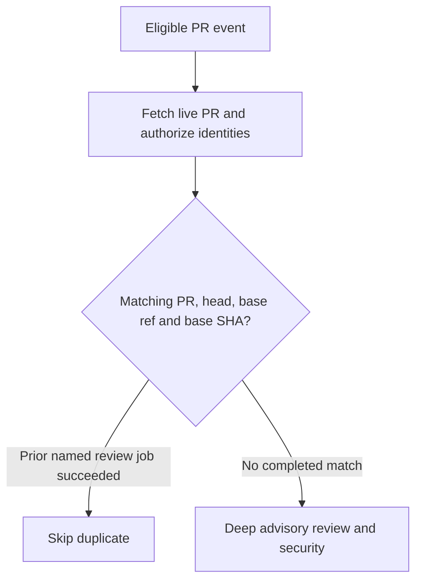

# Code review
Active contributors: Jason

## Purpose

`.github/workflows/factory-review.yml` runs native deep review and a security pass on eligible same-repository PRs. Reviews are advisory: both critical and high security blocking inputs are false. It neither merges work nor grants release authority.

## Key abstractions

The modern wrapper has an authorization job and a named execution job, `Advisory review and security`. `JHD_FACTORY_REVIEW_ENABLED` must equal `true`. The pinned native action receives `automatic_review`, `automatic_security_review`, `review_depth: deep`, and the explicit `factory-droid` bot allowlist.

The deduplication identity is **PR number + live head SHA + live base ref + live base SHA**. A green workflow run alone is insufficient: a matching earlier run must contain a successful job named `Advisory review and security`.

## Walkthrough

1. PR events include opened, synchronize, reopened, ready-for-review, edited, converted-to-draft, and closed. Only base-changing edits authorize review; title/body edits use a separate run-specific concurrency group so they do not cancel active review.
2. Initial guards exclude drafts, forks, and senders other than humans or the named Factory bot.
3. Authorization fetches the current PR. It must still be open, non-draft, same-repository, and match the event's head SHA and base ref.
4. Both actor and rerunner must have current `write` or `admin` permission, unless the identity is exactly `factory-droid[bot]`. Other bots are rejected.
5. The wrapper queries up to 100 successful `pull_request` runs for the live head, ignores the current run, and checks PR/base associations. It paginates jobs only for matching candidates and skips if the named review job succeeded.
6. Otherwise, a 60-minute job requires `FACTORY_API_KEY`, checks out the reviewed event head without persisted credentials, and invokes pinned v10.

A base branch advancing to another SHA does not itself fail the live-PR check. An old-base review does not suppress the new live-base identity. This does not introduce a base-push trigger: the workflow still needs one of its configured PR events.

Lifecycle and head events share PR-level cancellation with `cancel-in-progress: true`, allowing superseded runs to be cancelled. Closed/draft transitions should not be mistaken for requests to review closed or draft PRs.

## Historical note: legacy reusable reviewer retired

Until October 23, 2026, a separate older implementation lived alongside this wrapper: a reusable workflow with `workflow_call` and a direct opened-only PR trigger, an unpinned `Factory-AI/droid-action@main` reference, `allowed_bots: "*"`, and write-scoped permissions. Commit [`d8596c0`](https://github.com/Jason-Holt-Digital/factory-droid-workflows/commit/d8596c02157b11ee8e24893bb3dde508366572b3) (`ci: remove legacy reusable Droid review workflow (#2)`) deleted it the same day the native control plane landed, with a message explaining that the opt-in `factory-review` and `factory-mentions` wrappers replace the legacy Droid workflows and that keeping both would produce two reviews per PR once the replacements were enabled.

The deletion retires the callable interface; it does not by itself prove the replacement is enabled or canaried. The current wrapper above remains opt-in and advisory.

## Integration and modification entry points

Change triggers, live identity comparisons, cancellation groups, and the named-job check together with `tests/test_workflow_authorization.cjs`. Renaming the execution job also changes the deduplication contract. Change action pins only with provenance review in `docs/PROVENANCE.md`. See [PR commands](pr-commands.md) for human-triggered actions and [Security](../security.md) for credential boundaries.

## Key source files

| Source | Role |
|---|---|
| `.github/workflows/factory-review.yml` | Modern opt-in authorization and advisory review. |
| `tests/test_workflow_authorization.cjs` | VM execution of live-identity, job-success, rerunner, and concurrency checks. |
| `docs/PROVENANCE.md` | Pinned action and historical execution limitations. |

Scope: one workflow file; the one relevant shared test file gives a 1/1 structural ratio, not independently measured workflow coverage. The shared suite exercises this wrapper's authorization, deduplication, rerunner, and concurrency logic in a VM. Surveyed `origin/main` history contains one human author, Jason Holt, across the repository; no separate reviewer ownership is inferred. Historical setup or quota observations are not current hosted-run verification.
