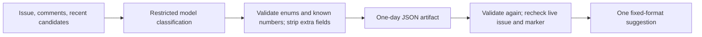

# Issue triage
Active contributors: Jason

## Purpose

`.github/workflows/factory-triage.yml` classifies newly opened GitHub issues. It produces a bounded suggestion for human review, not a ready label, assignment, closure, implementation branch, or PR. It is not scheduled source Intake or the Slack triage package.

## Key abstractions

Two jobs separate model access from publication:

- `classify`: 15 minutes, read-only contents/issues/PR token, default-branch checkout without persisted credentials.
- `publish`: five minutes, issue-write permission, deterministic artifact validation and comment construction, no model invocation.

`JHD_FACTORY_TRIAGE_ENABLED` must equal `true`. Per-issue concurrency does not cancel an active run. The only trigger is `issues.opened`; editing an issue does not enqueue another classification.

## Walkthrough

1. Fetch the live event issue. Skip PRs, closed issues, or an existing comment whose body starts with `<!-- jhd-factory-triage -->` and whose author is both `github-actions[bot]` and type `Bot`. A human copying the marker does not suppress triage.
2. Write `triage-context.json` with the issue number/title/body, paginated comments, and up to 100 most recently updated issues/PRs from the same repository, excluding the current issue. Candidate bodies are truncated to 500 characters; current issue and comments are not similarly truncated.
3. Record the original `issue.updated_at` and exact candidate-number list as job outputs.
4. Invoke pinned `Factory-AI/droid-action/base-action` with `--only-tools Read,Glob,Grep,ApplyPatch`, at most 30 turns. The prompt instructs it to treat all content as evidence and write only `triage-result.json`. No shell or connector tools are allowed.
5. Before artifact upload, deterministic JavaScript validates values and rewrites the result to only the three allowed fields, deduplicating numbers. Free text and extra keys never cross the artifact boundary.
6. Upload only that sanitized result as `issue-triage`, retained for one day. The raw context is not handed to the publisher.
7. In the write job, validate the artifact again, this time rejecting extra keys. Fetch the original issue and stop if it is now a PR, closed, or has a different timestamp.
8. Recheck the bot-owned marker, deduplicate/remove self references, and fetch each suggested related issue/PR before posting the fixed-format comment.

## Result contract

| Field | Allowed value |
|---|---|
| `type` | `bug`, `feature`, `question`, `maintenance` |
| `route` | `needs-info`, `human-review`, `documentation`, `security` |
| `duplicates` | Array of at most five safe integer issue/PR numbers present in the captured candidate list. |

The prompt requests positive numbers; the deterministic check enforces safe integers and membership in GitHub's known candidate numbers rather than a separate positive-number comparison. It checks the raw array length before deduplication. The recommendation never authorizes remediation, and the bounded recent list cannot prove there are no older duplicates.

## Integration and modification entry points

Change categories in the model prompt, sanitizer, publisher, and `tests/test_triage.cjs` together. Preserve sanitization **before** upload and timestamp/marker revalidation **after** download. Candidate discovery changes also change the accepted-number contract.

Tool allowlisting is not a filesystem sandbox: `ApplyPatch` remains a local write tool, constrained here by prompt intent and deterministic output filtering. Public issue authors can initiate paid runs once enabled. `docs/OPERATIONS.md` recommends a bounded private pilot before expansion. See [Security](../security.md) and [Data models](../reference/data-models.md).

## Key source files

| Source | Role |
|---|---|
| `.github/workflows/factory-triage.yml` | Context collection, restricted model run, sanitizer, artifact, and publisher. |
| `tests/test_triage.cjs` | VM tests of all three embedded scripts and tool arguments. |
| `tests/test_validate.py` | Shared policy checks against implementation/automatic-ready settings. |
| `config/jhd.json` | Declarative classification-only policy, not a runtime YAML import. |
| `docs/OPERATIONS.md` | Pilot and activation limits. |

Scope: one workflow file; two relevant shared test files give a 2/1 structural ratio, not coverage. The Python file checks JSON policy, not hosted YAML execution. Repository-wide surveyed `origin/main` history has one human author, Jason Holt. Historical preparation and passing local tests do not independently establish live triage or source writeback.
