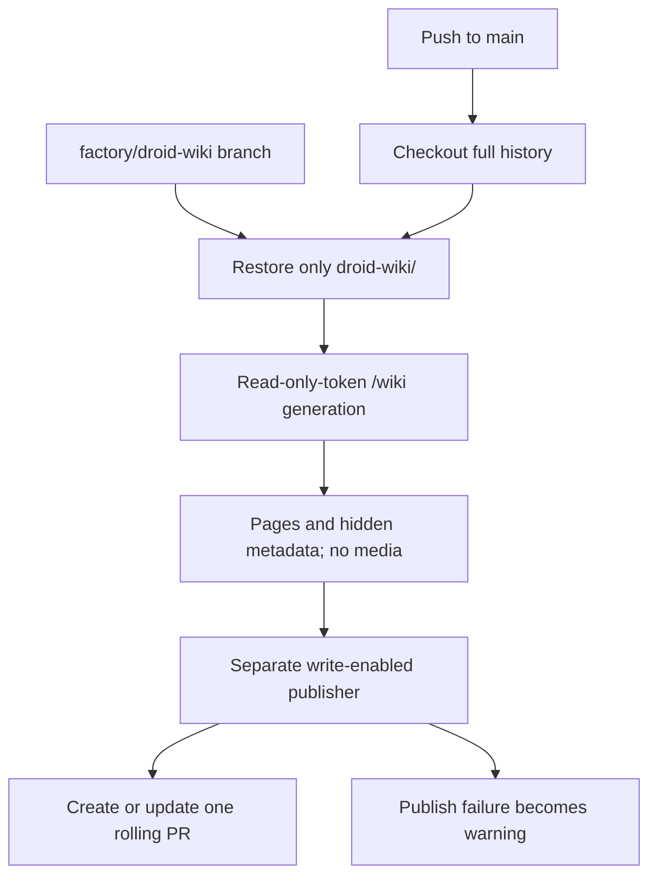

# Wiki refresh
Active contributors: Jason

## Purpose

`.github/workflows/droid-wiki-refresh.yml` refreshes generated documentation on pushes to `main` and opens or updates one rolling PR. There is **no JHD enable flag**. Merging the workflow into the default branch is an activation decision, not a gated dry run.

## Key abstractions

- `WIKI_BRANCH` is fixed to `factory/droid-wiki`.
- Repository-wide concurrency is fixed to `droid-wiki-refresh`, with `cancel-in-progress: false`; it prevents parallel full generations, while normal pending-run behavior retains the newest queued push.
- The generation job has `contents: read`. Only the separate publication job has contents/PR write permission.
- The rolling branch carries both pages and hidden `.wiki-meta.json`, so later runs can compare against prior generation.

## Walkthrough

1. Checkout uses full history. Fetch the rolling branch and restore only `droid-wiki/` without switching the source branch. If fetch/restore fails, continue with full generation rather than treating the missing prior wiki as fatal.
2. Install Factory Droid using the official installer command, then run `droid exec --auto high "/wiki"` with `FACTORY_API_KEY`. Read-only here means GitHub token permissions; generation still writes local wiki files.
3. Upload `droid-wiki` with `include-hidden-files: true`, excluding `droid-wiki/video/**` and `droid-wiki/images/**`. Retain the artifact for one day and fail if absent.
4. A separate job checks out source and downloads the artifact into `droid-wiki`.
5. Pinned `peter-evans/create-pull-request` updates `factory/droid-wiki` against the repository's default branch. Git add paths retain the same media exclusions. Commit/title are `docs: refresh wiki`; the PR label is `droid-wiki`.

The current trigger is explicitly `main`; PR-event exclusion conditions are retained template defenses, not additional configured triggers. If changing the repository default branch, review both the push filter and publisher base.

## Publishing and success criteria

The publisher chooses `FACTORY_WIKI_PR_TOKEN || github.token`. A dedicated optional token needs only repository contents/PR write scope. Without it, the approved documented path uses `GITHUB_TOKEN` plus the repository setting allowing Actions to create PRs. Do not widen an unrelated release token.

Fallback-created PRs do not trigger other workflows. `docs/OPERATIONS.md` calls for a person to close and reopen such a PR to start checks. That document's recorded permission/token observations are historical, not a live credential inventory.

The create/update step has `continue-on-error: true`; a subsequent step emits a warning on failure. Thus a green run or generated wiki is not proof of the rolling-PR outcome. Generation/cloud upload, when cloud sync is on, and repository publication are separate outcomes. Inspect the actual PR, metadata, media exclusions, and a later incremental update. A failed publication cannot provide a newly updated rolling snapshot for the next run, though an older rolling branch may still exist.

## Integration and modification entry points

Preserve the read/write job split, fixed branch/concurrency, full history, and hidden metadata when modifying the template. Keep artifact and Git media exclusions synchronized. Checkout/upload/download intentionally retain official `@v4` references; this is not the fully SHA-pinned pattern used by the modern review wrappers. See [Dependencies](../reference/dependencies.md) and [Deployment](../deployment.md) before activation or token changes.

## Key source files

| Source | Role |
|---|---|
| `.github/workflows/droid-wiki-refresh.yml` | Generation, rolling-state restore, artifact handoff, and publisher. |
| `docs/OPERATIONS.md` | Activation, fallback permissions, and observable canary outcome. |
| `docs/PROVENANCE.md` | Template provenance and historical verification limits. |

Scope: one workflow file; zero dedicated test files gives a 0/1 structural ratio. Shared repository validation does not exercise this publisher or prove cloud sync. Surveyed `origin/main` history has one human author, Jason Holt, repository-wide; no separate wiki-workflow ownership is inferred.
