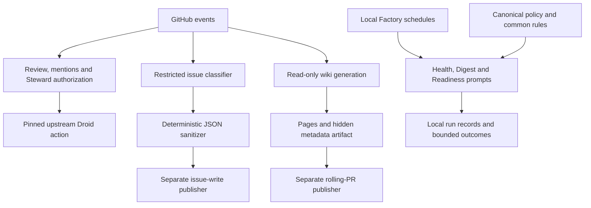

# Architecture

The repository is an automation control plane, not a running application. GitHub Actions handles repository events, while local Factory registrations run Markdown prompts on the Mac mini. `docs/OPERATIONS.md` describes the split; `config/jhd.json` records the shared policy.

## Components

Review, mentions, and Steward use the unchanged upstream action pinned in `docs/PROVENANCE.md`. Their eligibility logic is embedded JavaScript in `.github/workflows/factory-review.yml`, `.github/workflows/factory-mentions.yml`, and `.github/workflows/factory-ci-steward.yml`. The external action implements the model execution; its internals are not vendored here.

## Policy is declared, not injected

Local prompts read `config/jhd.json` through `automations/COMMON.md`. GitHub wrappers instead hardcode their switches, actor checks, and budgets in YAML and JavaScript. Changing JSON alone does not reconfigure hosted workflows. `scripts/validate.py` checks the JSON policy, not the entire workflow tree.

The legacy reusable reviewer was removed in `d8596c0` on October 23, 2026. `.github/workflows/factory-review.yml` is now the only checked-in automatic PR reviewer. Its enable variable still controls whether it runs; removal of the older workflow does not prove a successful hosted review. See [Code review](../features/code-review.md) and [Security](../security.md).

## Implementation languages

Python supplies `scripts/validate.py` and two unittest modules. CommonJS supplies two Node test files. YAML contains six workflows, including embedded JavaScript and shell commands; JSON contains one policy document. Markdown is executable task guidance for the local automations as well as human documentation. Exact physical-line measurements, including how embedded code is counted, are in [By the numbers](../by-the-numbers.md).

At `e5535c9`, 24 source-repository files contain 2,390 physical lines: 716 YAML, 720 CommonJS, 401 Python, 92 JSON, 456 Markdown, and five ignore-rule lines. These are file-format counts including comments and blanks, not executable statement counts. Generated wiki pages are excluded.

## State and persistence

There is no database or application API. Persistent records are GitHub issues, PRs and workflow runs; local evidence files specified by `automations/COMMON.md`; and generated wiki pages plus hidden metadata carried by `.github/workflows/droid-wiki-refresh.yml`. Linear and Sentry ownership mappings in `config/jhd.json` are enrollment declarations, not proof that source synchronization works.

The important boundary is who can write. Triage publishes only sanitized categories and candidate numbers. Wiki generation hands pages to a separate publisher. Local prompts prohibit production actions and retain private evidence outside tracked public content. See [Data models](../reference/data-models.md) for record shapes.
